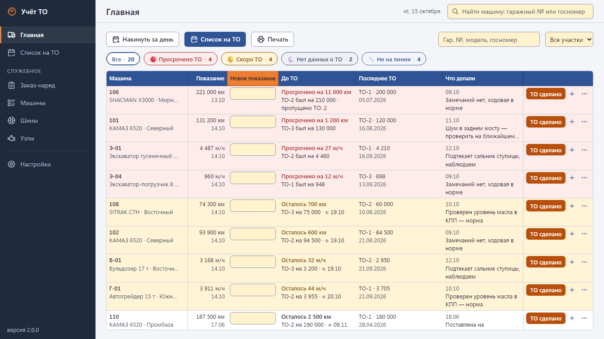

# Учёт ТО — fleet maintenance tracker

Офлайн-программа для механика, который ведёт парк техники: по каждой машине считает остаток до ТО
(по пробегу или моточасам), подсвечивает «просрочено / скоро ТО», ведёт журнал ремонтов и простоев,
шины и узлы, печатает заказ-наряд и список на ТО под заказ масла и фильтров.

Сделано для парка спецтехники (93 машины) дочерней компании РЖД: заменило Google-таблицу, которую механик
вёл на вахте. В этом репозитории — код без данных заказчика; все примеры, скриншоты и демо-база вымышленные.



## English summary

**Fleet maintenance tracker** — an offline desktop app for a field mechanic running a fleet of heavy
equipment (dump trucks counted in km, excavators/dozers/loaders in engine hours). It computes the remaining
interval to the next service (TO-1/2/3 cycle) from the last service done, highlights overdue/upcoming units,
keeps a repair/downtime log, tracks tyres and components, prints work orders and a service shopping list,
and imports/exports the customer's Excel workbook. Built for a 93-unit fleet of a Russian Railways subsidiary.
Stack: Python standard library (`http.server`, `sqlite3`) + openpyxl, vanilla JS front end with no build step
and no CDN, shipped as a single PyInstaller `.exe` (including a 32-bit Python 3.8 build for Windows 7).
286 unit tests. UI and docs are in Russian.

## Возможности

- Главный экран — весь парк одной таблицей: ввод показаний со счётчиков подряд (Enter — следующая машина),
  остаток до ТО, пропущенные ТО, последняя запись по машине, фильтры «Просрочено / Скоро / Нет данных / Не на линии».
- «ТО сделано» с циклом ТО-1 → ТО-2 → ТО-3; показание на момент ТО отдельно от текущего.
- «Накинуть за день» — расчётная суточная наработка для машин на линии (с отменой за период).
- Список на ТО с горизонтом по средней наработке и сводкой «что заказать» по регламенту.
- Карточка машины: история, «как считается», шины, узлы, фото.
- Заказ-наряд и отчёт за день на печать (или в PDF).
- Импорт из Excel с предварительным отчётом (dry run) без дублей; выгрузка всей базы в Excel и обратно.
- Автокопии базы, восстановление из копии, самовосстановление при повреждённом файле.

Руководство пользователя — [docs/guide.md](docs/guide.md).

## Быстрый старт

Нужен Python 3.8+ и Edge или Chrome.

```
pip install -r requirements.txt
python run_dev.py --demo
```

Откройте http://127.0.0.1:8765/ — при первом запуске `seed_demo.py` создаст в `demo-data/` вымышленный парк
из 20 машин (просроченные и близкие ТО, ремонт, простой, консервация, шины, узлы). Даты считаются от
сегодняшнего дня, поэтому картина всегда одинаковая. Пересоздать демо-базу: `python seed_demo.py --force`.

Запуск как у пользователя (сервер + окно браузера в режиме приложения, данные в `data/`):

```
python -m app.main
```

## Тесты

```
python -m unittest discover -s tests -v
```

286 тестов: расчёт ТО и состояний (`test_logic`), сервисный слой (`test_services`), HTTP API, включая защиту
от path traversal (`test_api`), импорт/экспорт xlsx (`test_xlsx`) и нагрузочный тест на 250 машин × 400 записей
журнала (`test_perf`, отключается `TO_SKIP_PERF=1`). Те же тесты гоняются в GitHub Actions на Windows.

## Сборка exe

- `build.bat` — один `dist\TO-Uchet.exe` (PyInstaller onefile, 64 бит). Нужен `.venv` с `openpyxl` и `pyinstaller`.
- `build-compat.bat` — 32-битный exe на Python 3.8 для Windows 7 SP1 / 8.1 / 10 / 11 (путь к Python — переменная `PY38`).
- `package.ps1` — zip для передачи пользователю (exe, база из `dist\data`, если есть, PDF-инструкция, README.txt).

Данные программа хранит в папке `data` рядом с exe: база `to.db`, копии `backups/`, фото `photos/`, журнал `app.log`.

## Формат импорта

Импорт рассчитан на книгу «Журнал учёта техники и ТО» версии 8 — пример с синтетическими данными:
[examples/demo-v8.xlsx](examples/demo-v8.xlsx). На каждом листе строки 1–3 — заголовок и пояснения,
**строка 4 — шапка, данные с 5-й строки**. Программа узнаёт листы по ключевым словам в шапке, так что
формулировки заголовков могут немного отличаться. Обязательны листы «Машины» и «Журнал», остальные — по желанию.

| Лист | Столбцы |
|---|---|
| **Машины** | A №, B Модель / тип техники, C Гаражный № *, D Госномер, E VIN, F Моточасы / пробег при регистрации, G Участок / объект, H Гарантийный срок, I Фото таблички (ссылка), J Примечание, K Статус машины (В работе / На консервации / Списана), L Тип машины (для заказ-наряда) |
| **Журнал** (и необязательный **Архив журнала** того же вида) | A Дата *, B Смена, C Машина (гаражный №) *, D Событие * (ТО-1/2/3, Ремонт, Простой, Заметка, Отметка моточасов), E Моточасы / км, F Заехала — время, G Вышла — дата, H Вышла — время, I В ремонте всего (не читается, считается), J Что делалось, K Масло / запчасти, L Заказать запчасти, M Замечания, N Кто, O Заказано (дата) |
| **Шины** | A № шины, B Гаражный №, C Тип / размер, D Позиция, E Дата установки, F Ресурс, G Пробег / наработка, H–J расчётные, K Примечание |
| **Узлы** | A Машина (гаражный №), B Узел, C Ресурс / гарантия, D Показание машины при установке, E–H расчётные, I Рекомендация |
| **Регламент ТО** | A Тип ТО, B Периодичность, C Работы, D Масло / жидкости, E Фильтры, F Прочие запчасти, G Примечание |
| **Настройки** | A/B — параметры (интервал ТО и порог «скоро ТО» в моточасах, суточная норма и т. п.); списки: D события, F узлы, H размеры шин, J позиции колёс, L участки; N–P — правила для техники на километрах (слово в модели, интервал ТО, порог) |

\* — без этих полей строка пропускается с предупреждением. Машины с маркой из столбца N считаются в километрах,
остальные — в моточасах. Дубли (уже загруженные машины и события) не создаются, поэтому свежую выгрузку
можно загружать повторно. Выгрузка из программы (`Настройки → Данные → Выгрузить в Excel`) добавляет справа
служебные столбцы, чтобы файл импортировался обратно без потерь.

## Архитектура

```
app/main.py        точка входа: выбор порта, один экземпляр, окно Edge/Chrome --app, автовыключение
app/server.py      http.server: JSON API /api/*, статика, загрузка файлов, защита путей
app/services.py    сценарии (сохранить показания, ТО сделано, накинуть за день, план, заказ-наряд…), 409 «нужно подтверждение»
app/logic.py       чистые функции расчёта: показание на дату, статус ТО, цикл ТО, состояния, длительности
app/db.py          SQLite: схема, миграции, справочники по умолчанию, резервные копии и восстановление
app/xlsx_io.py     импорт таблицы v8 (с dry run) и экспорт в xlsx (openpyxl)
app/static/        фронтенд: ванильный JS (ES-модули, без сборки и CDN), CSS, иконки Tabler
seed_demo.py       демо-данные: синтетическая книга v8 → штатный импорт в demo-data/to.db
tools/screenshots.py  скриншоты docs/img на демо-данных через headless Edge/Chrome
tests/             unittest, 286 тестов
docs/              SPEC (полная спецификация), ТЗ, концепция v2, руководство пользователя
```

Всё работает локально: сервер слушает только 127.0.0.1, интернет не нужен, единственная внешняя зависимость
времени выполнения — openpyxl (подключается только при импорте/экспорте). Подробности — [docs/SPEC.md](docs/SPEC.md).

Разработано в связке с Claude Code.

## Лицензия

MIT — см. [LICENSE](LICENSE). Иконки — Tabler Icons (MIT), см. [NOTICE](NOTICE).
