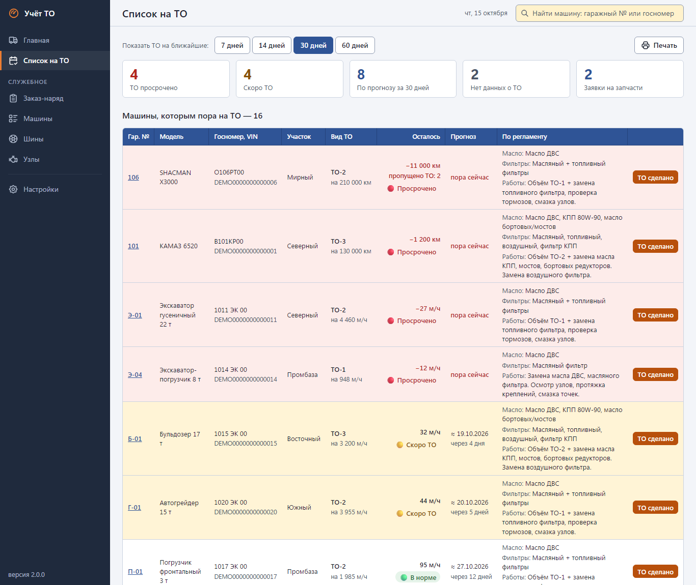
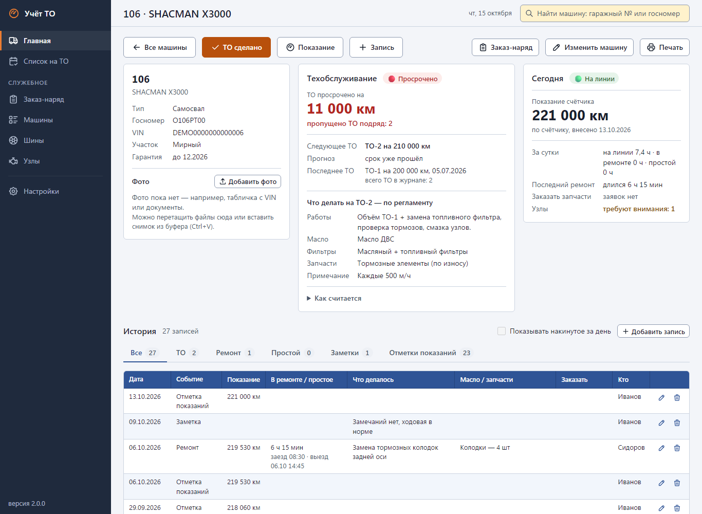
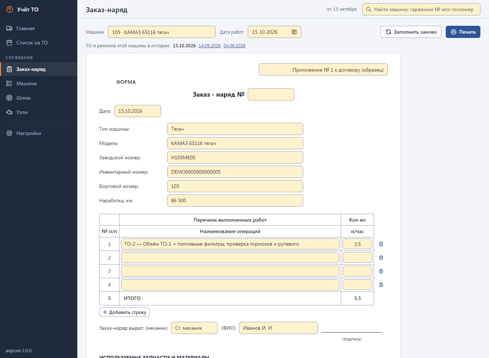
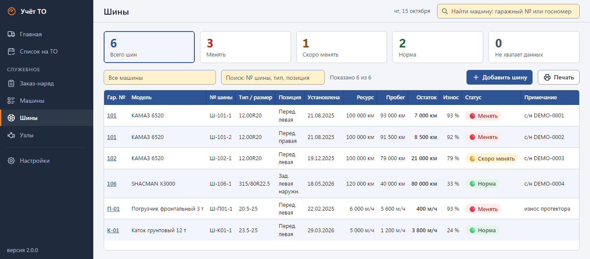
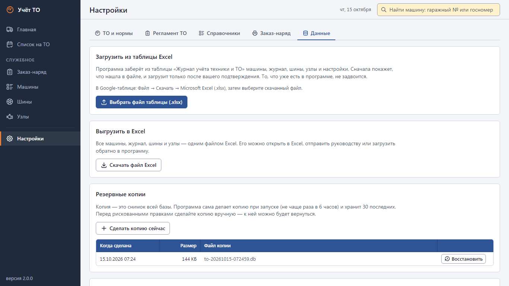

# Учёт ТО — руководство пользователя

Программа для механика, который ведёт парк техники: самосвалы считаются по километрам, экскаваторы,
бульдозеры, погрузчики, катки и грейдеры — по моточасам. Программа держит журнал работ, сама считает,
сколько осталось до следующего ТО, и подсвечивает машины, которым ТО пора делать или уже просрочено.
Интернет не нужен: всё хранится в одном файле базы рядом с программой.

Картинки в этом руководстве сняты на демо-данных (`python run_dev.py --demo`): парк, номера и фамилии вымышленные.

## 1. Запуск

1. Дважды щёлкните **TO-Uchet.exe**. Через несколько секунд откроется окно программы — это окно Edge
   (или Chrome) без адресной строки.
2. Закончили работу — закройте окно. Программа выключится сама примерно через полторы минуты.

Важно:

- **TO-Uchet.exe и папка `data` должны лежать в одной папке** — в `data` хранится вся база. Без неё программа
  запустится пустой.
- Папку с программой можно носить на флешке. Перед тем как вынуть флешку, закройте окно и подождите пару минут.
- Повторный запуск exe не открывает вторую копию программы — показывает окно уже работающей.

## 2. Первый запуск: откуда взять данные

Пустая база открывается на экране «Первый запуск». Два пути:

- **Загрузить таблицу Excel.** Если парк уже ведётся в таблице «Журнал учёта техники и ТО» (формат v8,
  листы и столбцы описаны в README, раздел «Формат импорта»): в Google-таблице — **Файл → Скачать →
  Microsoft Excel (.xlsx)**, в программе — **«Выбрать файл таблицы»**. Программа сначала покажет, что нашла
  в файле (сколько машин, записей, какие строки вызвали вопросы), и загрузит только после подтверждения.
- **Начать с пустой базы** — добавить первую машину вручную.

Позже свежую таблицу можно загрузить ещё раз: **Настройки → «Данные» → «Загрузить из таблицы Excel»**.
То, что уже есть в программе, не задвоится; перед загрузкой программа сама делает резервную копию базы.

## 3. Главный экран

Одна таблица на весь парк: строка — машина. Здесь делается почти вся работа.

- **Кремовые поля** — сюда вписываете вы (новое показание счётчика; у машин без внесённого ТО — ещё и
  последнее ТО). **Белые ячейки** считает программа.
- **Красная строка** — ТО просрочено, **жёлтая** — скоро ТО. Порядок по умолчанию — «сначала просроченные».
- Колонки: **«Машина»** (гаражный номер, модель, участок; если машина не на линии — что с ней и сколько уже),
  **«Показание»** (знак ≈ — расчётное показание), **«Новое показание»**, **«До ТО»** (сколько осталось или на
  сколько просрочено, сколько ТО пропущено), **«Последнее ТО»**, **«Что делали»** (последняя запись по машине)
  и кнопки справа.
- Над таблицей: поиск (гаражный номер, модель, госномер, VIN, участок), выбор участка и фильтры
  **«Просрочено ТО»**, **«Скоро ТО»**, **«Нет данных о ТО»**, **«Не на линии»** (число — сколько таких машин).
  Повторное нажатие снимает фильтр, **«Сбросить»** возвращает всё как было.
- Щелчок по строке открывает карточку машины.

## 4. Распорядок работы

### Начало смены (заезд на вахту): показания со счётчиков

- В колонке **«Новое показание»** впишите пробег или моточасы каждой машины. **Enter** (или ↓) — следующая
  машина, Shift+Enter (или ↑) — предыдущая. Если число меньше последнего известного, под полем появится подсказка.
- Если в колонке «До ТО» написано **«Внесите последнее ТО»**, в колонке «Последнее ТО» стоят кремовые поля:
  выберите вид ТО и впишите, на каком показании оно сделано. Такие машины быстро находит фильтр «Нет данных о ТО».
- Внизу появится панель: проверьте **«Дату показаний»** и нажмите **«Сохранить всё»** (или Ctrl+S). Программа
  покажет, сколько сохранено и сколько машин сейчас просрочено; строки перекрасятся.
- Сомнительное число (меньше прежнего, слишком большой скачок) — программа спросит: исправить или сохранить как есть.
  Уйти с экрана с несохранённым вводом без вопроса нельзя.

### В течение дня и вечером: записи о работах

- Кнопка **«+»** в строке машины — запись: **«Ремонт»**, **«Простой»** или **«Заметка»** и что делали
  (колодки, масло, сварка…). Для ремонта и простоя — когда машина заехала и когда вышла; запчасти, которые
  нужно заказать, — в поле «Заказать запчасти».
- Машина вышла из ремонта — **«Закрыть ремонт»** (или **«Закрыть простой»**) в её строке.
- **«Накинуть за день»** — программа прибавит суточный пробег или моточасы машинам, которые были на линии
  (ремонт и простой пропускаются). Это оценка со знаком ≈: как только вы внесёте показание со счётчика, программа
  возьмёт его. Лишнее можно отменить кнопкой **«Отменить накинутое за период»**.

### Сделали ТО

Кнопка **«ТО сделано»** — в строке машины, в «Списке на ТО» и в карточке. Два поля:

- **«Показание на момент ТО»** — на каком пробеге или моточасах сделано ТО;
- **«Показание сейчас»** — что на счётчике сегодня (ТО могли сделать без вас и раньше).

Вид ТО подставляется сам и идёт по кругу: ТО-1 → ТО-2 → ТО-3 → ТО-1… Следующее ТО считается от сделанного,
а не от сегодняшнего показания: ТО на 150 000 км, сейчас 153 000, интервал 10 000 — следующее на 160 000,
осталось 7 000.

## 5. Список на ТО: что заказать

Кнопка **«Список на ТО»** над таблицей или в меню слева. Здесь машины с просроченным и близким ТО (горизонт
7/14/30/60 дней — по средней наработке каждой машины), что делать на каждом ТО по регламенту, сводка
**«Что заказать»** (масло, фильтры, запчасти по видам ТО и моделям) и открытые заявки на запчасти из записей.
Кнопка **«Печать»** печатает всё это на альбомном листе.

## 6. Карточка машины

Щелчок по строке на главном экране или поиск в верхней строке. В карточке: статус ТО и прогноз даты
следующего, что делать на ТО по регламенту, блок **«Как считается»** (откуда взяты интервал, норма и средняя
наработка), состояние сегодня, история всех записей с фильтрами по видам, шины и узлы машины, фото.
Кнопка **«← Все машины»** возвращает на главный экран в том же виде (фильтры не сбрасываются).

**Фото** (табличка с VIN, документы): «Добавить фото», перетаскивание файлов на блок или Ctrl+V из буфера.
Форматы jpg, png, webp, gif, до 25 МБ. Фото лежат в папке `data\photos` и в резервные копии базы не входят —
копируйте папку `data` целиком.

## 7. Заказ-наряд и печать

- **Заказ-наряд** (меню «Служебное», кнопка «⋯» в строке машины или кнопка в карточке): выберите машину и дату
  работ — форма заполнится ТО и ремонтами за этот день (работы, нормо-часы, запчасти, время). Любое поле можно
  поправить перед печатью; реквизиты шапки и строки подписи задаются в **Настройки → «Заказ-наряд»**.
- **Отчёт за день** — кнопка «Печать» на главном экране: таблица как на экране, без кнопок. Пустые кремовые поля
  печатаются пустыми рамками — получается бланк для обхода машин.
- PDF: в окне печати выберите принтер **«Сохранить в формате PDF»**.

## 8. Шины и узлы

Экраны **«Шины»** и **«Узлы»**: ресурс, пробег или наработка, остаток, износ и статус («Норма», «Скоро менять»,
«Менять» — пороги 75 % и 90 % задаются в настройках). Пробег узла считается сам от текущего показания машины.

## 9. Настройки

- **«ТО и нормы»**: интервал и порог «скоро ТО» для техники на моточасах; правила по маркам для техники на
  километрах (по умолчанию SHACMAN — 10 000 км; SITRAK, SANY, VOLVO — 15 000 км; русское написание марок тоже
  учтено); слова, по которым техника всегда считается в моточасах (экскаватор SANY останется на моточасах, хотя
  марка есть в правилах); суточные нормы для «Накинуть за день». Отдельной машине можно задать свой интервал,
  порог, норму и единицу учёта: карточка → **«Изменить машину»** → «Свои параметры ТО».
- **«Регламент ТО»**: что делается на каждом виде ТО — работы, масло, фильтры, запчасти.
- **«Справочники»**: виды событий, участки, типы машин, узлы, размеры шин, позиции колёс.
- **«Данные»**: загрузка из Excel, выгрузка всей базы в Excel (её можно загрузить обратно), резервные копии.

## 10. Резервные копии

- Программа сама копирует базу в `data\backups` при запуске (не чаще раза в 6 часов) и перед каждой загрузкой
  таблицы; хранятся последние 30 копий.
- Копия вручную: **Настройки → «Данные» → «Сделать копию сейчас»**. Восстановление — кнопка **«Восстановить»**
  у нужной копии; текущая база перед этим тоже сохраняется в копию.
- Время от времени копируйте папку с программой целиком (вместе с `data`) на другой диск.

## 11. Если что-то не так

| Что случилось | Что делать |
|---|---|
| Программа не запускается | Проверьте, что рядом с TO-Uchet.exe есть папка `data` и что флешка не защищена от записи. Причина записана в файле `data\app.log` |
| База повреждена | Программа сама откладывает испорченный файл и поднимает самую свежую исправную копию из `data\backups` (на экране будет пояснение). Вручную: закройте программу, переименуйте `data\to.db`, положите на его место свежую копию из `backups` под именем `to.db` |
| Не открывается окно | Нужен Microsoft Edge или Google Chrome (в Windows 10/11 Edge есть всегда) |
| Windows пишет «Система Windows защитила ваш компьютер» | «Подробнее» → «Выполнить в любом случае» (exe не подписан сертификатом) |
| Windows 7: «отсутствует api-ms-win-crt-runtime-l1-1-0.dll» | Установить обновление KB2999226 или Visual C++ Redistributable 2015–2019 x86 |
